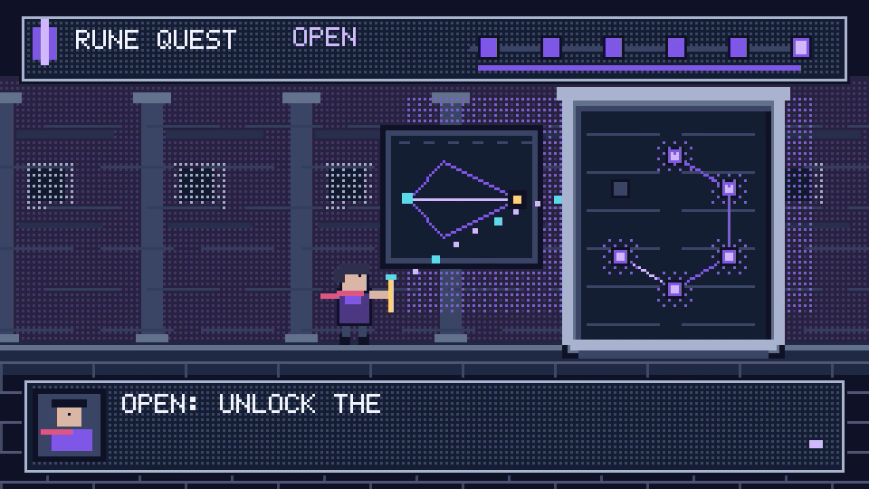

# 像素游戏视频 Skill

让具有文件读写、代码运行和本地浏览器能力的 AI，把你的主题、文案或原声制作成像素游戏视频。**导演规则＋代码画面＋原创音效＋可视工作台＋本地导出与检查**，完整放在本仓库。

适用于像素科普、游戏化叙事、产品与旅程故事。无需付费视频模型、Remotion 或私人 Skill。技能不能代替 AI 的理解与设计，运行条件也必须具备；“拿到技能”不等于任意 AI、任意电脑自动达到全部艺术效果。



[20 秒有声示例](demo.mp4) · [12 秒商路画面示例（静音）](trade-silent.mp4) · [导演入口](SKILL.md) · [风格方法](STYLE.md) · [两种示例分镜](STORYBOARD.md)

## 给其他 AI 使用

下载仓库，交给 AI 读取 `SKILL.md`。支持目录型 Skill 的客户端可以将整个目录放到自己的技能目录；不支持的客户端也可读取文件并执行，不能只复制一段提示词而漏掉代码。

可以直接给 AI 这段任务：

> 读取这个目录的 SKILL.md，按我的主题／原声制作像素游戏视频。先理解内容并设计可见事件，用一份当前分镜指导制作；保留指定原声与顺序。复用画法，重写人物、场景和动作，不只替换演示标题。制作必要预览、自检、局部返修，交付成片、可视预览和工程。缺工具或缺输入先明确说明。

## 三步运行公开示例

需要 Node.js ≥22、Chrome／Chromium、FFmpeg 与 ffprobe（均可从命令行调用）。Python 3 只用于可选解码检查，不需要 Pillow。仓库带完整成片；画面素材、字体与声音也可由代码重建。

在仓库根目录执行：

```sh
npm ci
npm run preview
```

打开提示的本地地址，可播放、暂停、拖时间轴，切换符文／商路案例。默认端口 8780，仅监听本机；占用时设置 `PORT` 后重启。浏览器不能直接通过 `file://` 加载模块，应使用这个本地预览入口。

需要自行重建有声视频时另开终端：

```sh
npm run audio
npm run render
```

得到 `output/demo.mp4`：1920×1080、24 fps、20 秒、H.264／AAC。脚本不覆盖已有输出；重复渲染请换文件名：

```sh
node render.mjs --page demo.html --audio demo.wav --out output/demo-v2.mp4
```

Chrome 未自动找到时，用 `CHROME_PATH` 指定实际可执行文件。Windows PowerShell 示例：

```powershell
$env:CHROME_PATH = 'C:/Program Files/Google/Chrome/Application/chrome.exe'
npm run render
```

Linux／macOS 使用对应的系统路径。不要为了启动方便添加 `--no-sandbox`，也不需要浏览器登录、API key 或全局配置改动。

## 换内容与接入原声

- `project.js` 配置当前示例文字、时间与声音事件。`quest.js` / `trade.js` 是画面实现；新内容需要设计并重写相应场景。改标题不是完整制作。
- 新渲染页提供 `window.DUR`、`window.READY`、`window.render(t)`；所有可见内容画进原生 Canvas。只做一份当前分镜，按实际原声修正时序。
- 原声时轴与画面一致时，直接 `--audio your-audio.wav`。取原曲区间时，先按原声时间建立页面，`--start` / `--end` 同时裁取画面与音频；不要把已经裁好的音频再按原曲偏移重复裁切。
- 导出器不会录浏览器里的声音，它使用 `--audio` 指定的完整混音。缺省导出明确为静音音轨。音频短于所选范围会停止，不悄悄补空白。
- 要给用户原声加本例动作音效，可先生成独立效果音：

```sh
node make-audio.mjs --sfx-only --out output/effects.wav
ffmpeg -n -i your-audio.wav -i output/effects.wav -filter_complex "[0:a][1:a]amix=inputs=2:duration=first:normalize=0,alimiter=limit=0.95:level=false[a]" -map "[a]" output/mix.wav
node render.mjs --page your-film.html --audio output/mix.wav --out output/your-film.mp4
```

上面示例只适合 **20 秒、事件已对齐** 的音频；其他片长先改声音生成器及事件。音效音量需合播检查，不靠这一条命令保证听感。默认不替换用户声音，不生成未授权配音。

## 检查与边界

```sh
npm test
npm run check
python -X utf8 verify_video.py output/demo.mp4
```

检查符文状态／音效同步、角色位置、随机跳转、透明覆盖、最近邻放大、关键画面、视频／音轨与完整解码。`output/` 放检查截图。**不自动判断语义生动、连续表演或音效合播是否好看好听。** 正常速度连续听看和用户认可另记，见 [VALIDATION.md](VALIDATION.md)。

示例位图字体是英文，不带 CJK 字库；中文等字体适配及外部 PNG 检查方法写在 STYLE.md。当前代码提供像素表现与渲染链，不提供任意卡通肢体骨骼、自动 ASR／对齐、通用字幕排版或任意声音生成器。这些只在实际影片需要时补齐，不强加到每个项目。

## 来源与许可

本仓库原创导演方法、场景与工具按 MIT 开源，可修改及商用，遵守 [LICENSE](LICENSE)。像素基础工具 `pixel-primitives.js` 来自 Lemo-Opuscar，保留其 MIT 许可与出处，详见 [THIRD_PARTY_NOTICES.md](THIRD_PARTY_NOTICES.md)。没有打包私人歌曲、真人录音、用户聊天、受保护游戏资产或密钥。
